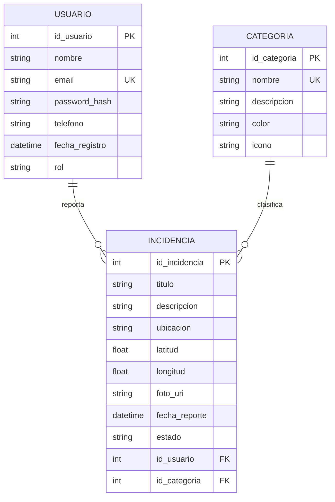

# Diagrama Entidad-Relación (ER) - CityReport

**Proyecto base:** HelloCityReport (https://github.com/Yamilipn/HelloCityReport)  
**Modelo de datos:** CityReport  
**Entidades principales:** `Usuario`, `Categoria`, `Incidencia`

---

## 1. Descripción del modelo

CityReport permite que los ciudadanos reporten incidencias urbanas (baches, alumbrado, fugas, etc.).
Cada incidencia es reportada por un **Usuario** y pertenece a una **Categoria**.
El modelo relacional se compone de tres tablas:

- **Usuario**: personas que reportan incidencias.
- **Categoria**: clasificación de la incidencia (bache, alumbrado, basura, etc.).
- **Incidencia**: reporte individual con título, descripción, ubicación, fecha y estado.

---

## 2. Diagrama ER (Mermaid)

> GitHub renderiza automáticamente los bloques `mermaid` en archivos Markdown, por lo que el diagrama se visualiza directamente en el repositorio.

---

## 3. Tablas y campos principales

### 3.1 Usuario

| Campo | Tipo | Restricciones | Descripción |
|---|---|---|---|
| `id_usuario` | INT | PK | Identificador único del usuario. |
| `nombre` | VARCHAR(100) | NOT NULL | Nombre completo del usuario. |
| `email` | VARCHAR(150) | UNIQUE, NOT NULL | Correo electrónico (login). |
| `password_hash` | VARCHAR(255) | NOT NULL | Contraseña cifrada. |
| `telefono` | VARCHAR(20) | NULL | Teléfono de contacto. |
| `fecha_registro` | DATETIME | NOT NULL | Fecha de alta en el sistema. |
| `rol` | VARCHAR(30) | NOT NULL | Rol: ciudadano, operador, admin. |

### 3.2 Categoria

| Campo | Tipo | Restricciones | Descripción |
|---|---|---|---|
| `id_categoria` | INT | PK | Identificador único de la categoría. |
| `nombre` | VARCHAR(60) | UNIQUE, NOT NULL | Nombre de la categoría (Bache, Alumbrado, etc.). |
| `descripcion` | VARCHAR(255) | NULL | Descripción de la categoría. |
| `color` | VARCHAR(10) | NULL | Color para UI (hex). |
| `icono` | VARCHAR(50) | NULL | Nombre del icono asociado. |

### 3.3 Incidencia

| Campo | Tipo | Restricciones | Descripción |
|---|---|---|---|
| `id_incidencia` | INT | PK | Identificador único de la incidencia. |
| `titulo` | VARCHAR(120) | NOT NULL | Título corto del reporte. |
| `descripcion` | TEXT | NOT NULL | Descripción detallada. |
| `ubicacion` | VARCHAR(200) | NOT NULL | Dirección o referencia textual. |
| `latitud` | FLOAT | NULL | Coordenada geográfica. |
| `longitud` | FLOAT | NULL | Coordenada geográfica. |
| `foto_uri` | VARCHAR(500) | NULL | URI de la foto de evidencia (opcional). |
| `fecha_reporte` | DATETIME | NOT NULL | Fecha y hora del reporte. |
| `estado` | VARCHAR(30) | NOT NULL | Pendiente, En proceso, Resuelta. |
| `id_usuario` | INT | FK → Usuario.id_usuario | Usuario que reporta. |
| `id_categoria` | INT | FK → Categoria.id_categoria | Categoría de la incidencia. |

---

## 4. Relaciones

1. **Usuario (1) — Incidencia (N)**  
   Un usuario puede reportar muchas incidencias, pero cada incidencia pertenece a un único usuario.

2. **Categoria (1) — Incidencia (N)**  
   Una categoría agrupa muchas incidencias, pero cada incidencia tiene una única categoría.

3. **Incidencia (N) — Usuario (1) y Categoria (1)**  
   La tabla `Incidencia` contiene las llaves foráneas `id_usuario` y `id_categoria`, que referencian a `Usuario` y `Categoria` respectivamente.

---

## 5. Reglas de integridad sugeridas

- `ON DELETE RESTRICT` en `Incidencia.id_usuario` para evitar borrar usuarios con incidencias asociadas (o `CASCADE` si se desea borrar en cascada).
- `ON DELETE RESTRICT` en `Incidencia.id_categoria` para no eliminar categorías en uso.
- Índices en `Incidencia.id_usuario`, `Incidencia.id_categoria` y `Incidencia.estado` para mejorar consultas.
- `email` único en `Usuario`; `nombre` único en `Categoria`.

---

## 6. Notas de implementación (Android / Room)

- En Room, `Incidencia` sería una `@Entity` con `@ForeignKey` hacia `Usuario` y `Categoria`.
- Los DAOs expondrían consultas como `getIncidenciasPorUsuario`, `getIncidenciasPorCategoria`, etc.
- Para persistencia local se recomienda Room (SQLite). Preferencias simples (tema, filtros) pueden ir en DataStore.

---

## 7. Visualización

El diagrama se renderiza automáticamente en GitHub a partir del bloque `mermaid` de la sección 2.
Para una vista rápida en clase también se puede pegar el bloque en cualquier visor Mermaid (https://mermaid.live).
