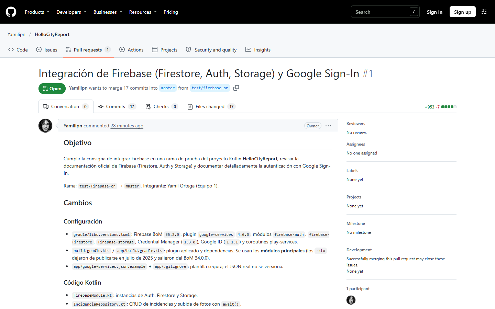
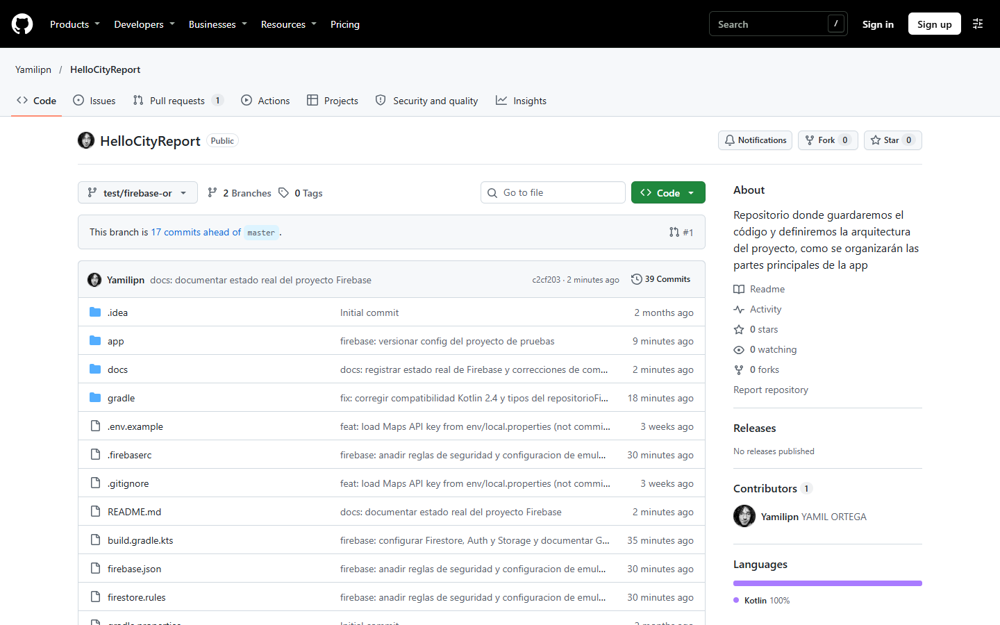
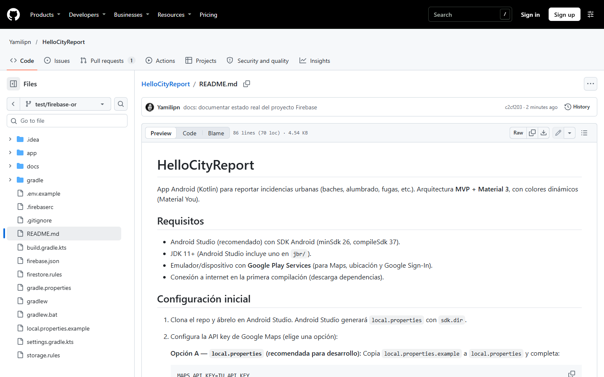
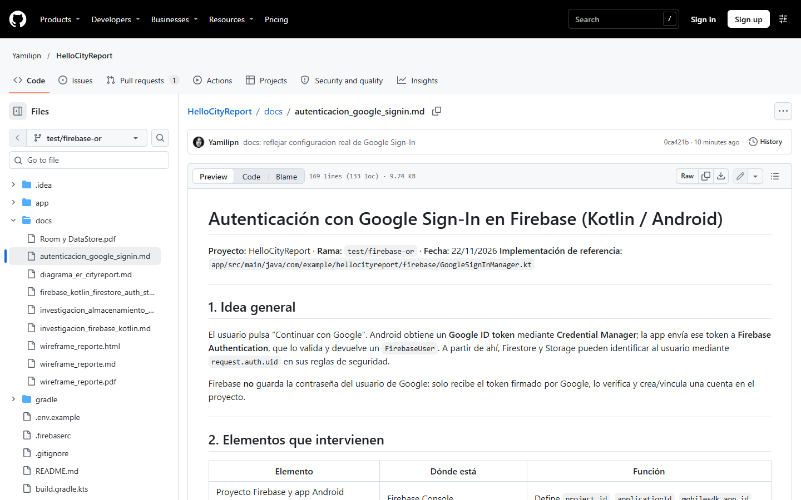

# Firebase en HelloCityReport — avance del equipo

**Equipo 1** · Noviembre de 2026  
**Repositorio:** https://github.com/Yamilipn/HelloCityReport

---

## La consigna

Nos pidieron revisar la documentación de Firebase para Kotlin, centrándonos en Firestore, Authentication y Storage; configurar Firebase en una rama de prueba del proyecto; documentar cómo funciona el acceso con Google; y dejar un reporte de lo que aprendimos. Este documento reúne el avance que tenemos hasta ahora y las capturas del trabajo ya subido al repositorio.

## Lo que revisamos de la documentación

Estuvimos leyendo las guías oficiales de Firebase para Android:

- **Configuración inicial**: crear el proyecto, registrar el paquete de la app, descargar `google-services.json` y agregar el plugin de Gradle.
- **Firestore**: colecciones y documentos, lectura y escritura, consultas, tiempo real y reglas de seguridad.
- **Authentication**: el objeto `Firebase.auth`, el estado de la sesión y los proveedores habilitados desde la consola.
- **Storage**: el bucket de Cloud Storage, las referencias a archivos y la subida de imágenes.
- **Google Sign-In**: la versión actual del flujo usa Credential Manager, que entrega un ID token de Google y Firebase lo valida.

Un detalle que nos sirvió mucho: Firebase ya no publica los módulos `-ktx` por separado. Las extensiones de Kotlin están dentro de los módulos principales, así que el proyecto depende de `firebase-auth`, `firebase-firestore` y `firebase-storage` directamente, con el BoM controlando las versiones.

## Dónde quedó el trabajo

Todo está en la rama **`test/firebase-or`** y con unaPull Request abierta hacia `master` para que el equipo lo revise y lo pruebe en su propio dispositivo.

| Parte | Archivos |
|---|---|
| Dependencias | `gradle/libs.versions.toml`, `build.gradle.kts`, `app/build.gradle.kts` |
| Configuración de Firebase | `app/google-services.json`, `app/google-services.json.example`, `app/.gitignore` |
| Código | `FirebaseModule.kt`, `IncidenciaRepository.kt`, `GoogleSignInManager.kt` |
| Reglas y emuladores | `firestore.rules`, `storage.rules`, `firebase.json`, `.firebaserc` |
| Documentación | guía de Firestore/Auth/Storage, guía de Google Sign-In, reporte de indagación y README |

La idea es que Firestore lleve las incidencias, Storage guarde las fotos y Auth sea la forma de identificar a quien reporta. Room y DataStore siguen siendo útiles para la caché local del dispositivo.

## El proyecto Firebase que creamos

- Proyecto: **hellocityreport-test**.
- App Android registrada con el paquete `com.example.hellocityreport`.
- Huella SHA-1 de depuración agregada al proyecto.
- Proveedor de **Google activado** en Authentication.
- Base de **Cloud Firestore** creada y con las reglas ya publicadas: solo usuarios con sesión pueden leer, y cada incidencia solo puede ser editada por quien la creó.
- El `google-services.json` se descarga de la consola y se guarda en cada máquina (está en `.gitignore`); en la rama queda la plantilla `.example` como referencia.

La app compila con `./gradlew assembleDebug` y genera el APK sin problemas.

## Cómo queda conectado el acceso con Google

El recorrido completo es este:

1. El usuario pulsa *Continuar con Google*.
2. **Credential Manager** muestra las cuentas disponibles usando `GetGoogleIdOption`. El `serverClientId` sale de `R.string.default_web_client_id`, que genera el plugin a partir del cliente OAuth web del `google-services.json` (`client_type: 3`).
3. La respuesta trae una credencial de tipo Google ID; `GoogleIdTokenCredential` extrae el **ID token**.
4. `GoogleAuthProvider.getCredential()` convierte ese token en una credencial de Firebase.
5. `FirebaseAuth.signInWithCredential()` lo valida y devuelve el **FirebaseUser** con su `uid`, nombre, correo y foto.
6. Ese `uid` es el que después se usa en las reglas de Firestore y Storage (`request.auth.uid`).
7. Al cerrar sesión se llama a `signOut()` y también a `ClearCredentialStateRequest` para limpiar la cuenta recordada por el sistema.

Los archivos con el paso a paso y el código están en `docs/autenticacion_google_signin.md`.

## Capturas del trabajo

**Pull Request con el avance y su descripción:**

**Rama de prueba y archivos que quedaron en ella:**

**README con las instrucciones de integración:**

**Documentación de Google Sign-In:**

## Lo que sigue

- Habilitar Cloud Storage: Firebase pide vincular una cuenta de facturación (plan Blaze) para crear el bucket. El código y `storage.rules` ya están listos; falta ese paso en la consola.
- Registrar el SHA-1 de release cuando tengamos el keystore de producción.
- Probar en un dispositivo o emulador con Google Play Services el inicio de sesión y la subida de fotos.
- Que cada integrante revise la PR y comente si quiere algún cambio antes de fusionarla.

Por ahora el equipo tiene una base configurada y documentada sobre la cual seguir trabajando.
